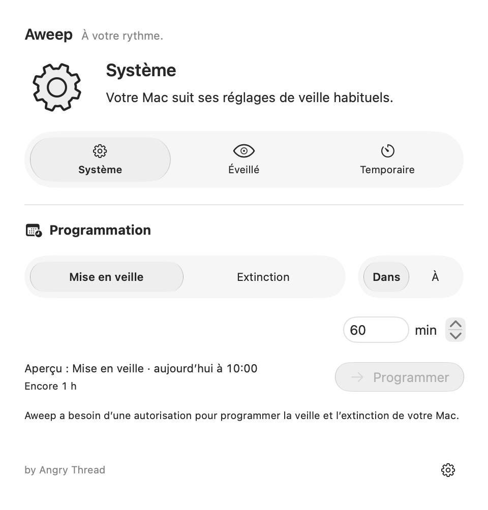
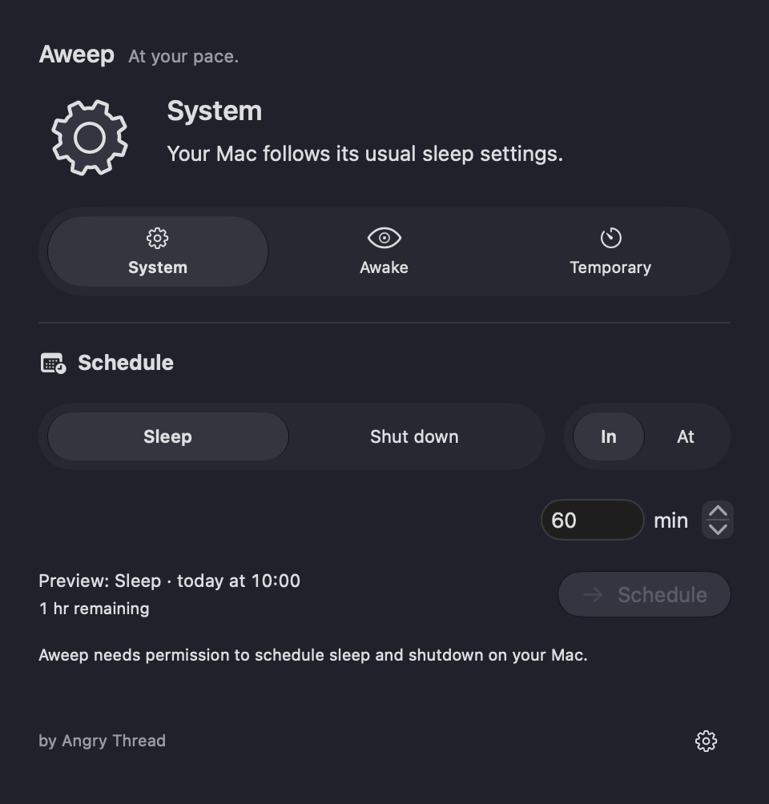

# Aweep 1.0.0

Garder le Mac éveillé, puis revenir simplement au comportement du système.
Aweep est une application native macOS par Angry Thread, en français et en anglais.

- **Système** : laisser macOS gérer la veille.
- **Éveillé** : maintenir le Mac éveillé.
- **Temporaire** : limiter le maintien éveillé à une durée choisie.
- **Transport** : disponible sur les portables compatibles, avec les protections
  prévues pour ce mode.
- Programmer une veille ou une extinction depuis l’interface, avec autorisation
  explicite du service Aweep.

macOS 26+ · Universal Apple silicon / Intel · barre des menus et fenêtre ·
apparence claire/sombre · Dock masquable.

[Téléchargements officiels](https://github.com/enrimerveille/aweep-releases/releases)
· [Installation](INSTALLATION.md) · [Mise à jour](UPDATE.md) · [Changelog](CHANGELOG.md)

Téléchargez `Aweep-1.0.0.dmg` depuis les assets de la release officielle.

**Distribution manuelle Apple Development, sans Developer ID ni notarisation.**
macOS peut refuser l’ouverture ; aucune promesse de passage transparent de
Gatekeeper. L’installation requiert les autorisations normales de macOS.
Sparkle détecte et vérifie les mises à jour ; vous installez ensuite le DMG.

Les captures préparées illustrent les vues natives avec des données de
démonstration ; elles ne constituent pas une qualification matérielle.

Sources privées, tous droits réservés.
